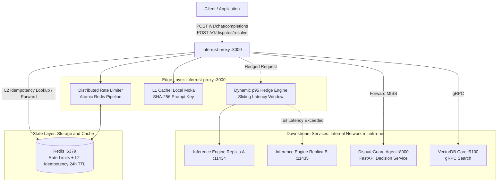

# inferrust-proxy ⚡

[](https://www.rust-lang.org/)
[](LICENSE)
[](Dockerfile)

A high-performance reverse proxy and edge sidecar gateway for LLM inference and AI microservices, written in Rust (Axum + Tokio).

It sits between client applications and downstream services (inference backends like vLLM/Ollama, vector databases, or decision agents like **DisputeGuard**), adding a **two-tier hybrid cache (L1 Moka + L2 Redis)**, distributed rate limiting, transactional idempotency enforcement, and tail-latency mitigation via hedged requests.

---

## 🏛️ System Architecture



---

## 💡 Why This Exists

- **Eliminate Redundant Inference:** Identical LLM completions are served sub-millisecond from in-memory cache, freeing GPU clusters from re-computing static prompts.
- **Transactional Idempotency at the Edge:** Protect downstream transaction services (such as dispute resolutions or refund processing) from duplicated requests during network retries using client-provided `Idempotency-Key` headers stored in Redis.
- **Curb Tail Latency (p95/p99):** Uses speculative execution (hedged requests) across backend replicas to drop outlier latencies caused by GPU prefill stalls and request queueing.
- **Resilient Rate Limiting:** Enforces token-aware and IP-based sliding window limits using Redis with zero-allocation fail-open semantics.

---

## ✨ Core Features

### 1. Two-Tier Hybrid Caching (L1 Moka + L2 Redis)

- **L1 In-Memory Cache (Moka):** Caches raw LLM completions by prompt SHA-256 hash. Returns zero-copy byte payloads directly via `axum::body::Body::from(cached_data)`.
- **L2 Distributed Idempotency (Redis):** On routes like `/v1/disputes/resolve`, the gateway captures the client's `Idempotency-Key` header. Cache hits return immediate `200 OK` with `x-cache: HIT` (<5ms). On cache misses (`x-cache: MISS`), the request is forwarded to downstream agents (e.g., DisputeGuard) and persisted in Redis with a 24-hour TTL (`SETEX 86400`).

### 2. Hedged Requests with Dynamic p95 Timeout

Implements speculative execution as detailed in *The Tail at Scale* (Dean & Barroso). The proxy maintains a thread-safe sliding window (`VecDeque<u64>`) of recent response times to dynamically calibrate the p95 threshold. If the primary replica does not yield response headers within this window, a concurrent hedged request is dispatched to replica B. First response wins; the trailing request is canceled.

### 3. Asynchronous SSE Stream Caching (Write-Behind)

For streaming requests (`stream: true`), tokens are streamed without latency penalty to the client via `tokio::sync::mpsc`. A detached task (`tokio::spawn`) aggregates chunks in the background and commits the full stream to cache once completed.

### 4. BPE Tokenizer & Rate Limiting

- Embeds Hugging Face's `tokenizers` engine in Rust. Long prompts are processed asynchronously via `tokio::task::spawn_blocking` to avoid blocking the Tokio async worker pool.
- Rate limiting operates on an atomic Redis transaction pipeline (`INCR` + `EXPIRE`), defaulting to fail-open availability if Redis becomes temporarily unreachable.

---

## 📡 Exposed Endpoints

| Method | Path | Target Backend | Cache / Idempotency Strategy |
| --- | --- | --- | --- |
| `POST` | `/v1/chat/completions` | vLLM / Ollama (`:11434`) | L1 Moka (SHA-256 Prompt Hash) + Dynamic Hedging |
| `POST` | `/v1/disputes/resolve` | DisputeGuard API (`:8000`) | L2 Redis (`idempotency:<UUID>` with 24h TTL) |
| `POST` | `/v1/vectors/search` | VectorDB Core (`:9100`) | gRPC passthrough + telemetry |
| `GET` | `/health` | Self | Gateway health check (`200 OK`) |
| `GET` | `/metrics` | Prometheus Scraper | Internal latency distributions and cache counters |

---

## ⚡ Quickstart

### Prerequisites

- Docker & Docker Compose (v2)
- Rust 1.75+ (only for native compilation)
- Downloaded `tokenizer.json` in the root folder (e.g., Llama-3 BPE tokenizer from Hugging Face)

### Option A: End-to-End Stack with DisputeGuard (Recommended)

Orchestrates the complete edge gateway, Redis, and the Python decision agent (`disputeguard`) on the shared `ml-infra-net` Docker network.

*(Requires both `inferrust-proxy` and `disputeguard` cloned into the same parent directory.)*

```bash
# From the inferrust-proxy directory:
docker compose -f docker-compose.integration.yml up --build -d
```

**Test 1: First Call (Cache MISS, processed downstream)**

```bash
curl -i -X POST http://localhost:3000/v1/disputes/resolve \
  -H "Content-Type: application/json" \
  -H "Idempotency-Key: ifood-order-uuid-9921" \
  -d '{
    "order_id": "ORD-9921",
    "customer_id": "CUST-4412",
    "dispute_text": "Delivery was delayed by 65 minutes, package was damaged.",
    "order_amount": 62.00
  }'
```

Notice header: `x-cache: MISS` (~850ms latency)

**Test 2: Duplicate Call (Cache HIT, returned from Redis)**

```bash
curl -i -X POST http://localhost:3000/v1/disputes/resolve \
  -H "Content-Type: application/json" \
  -H "Idempotency-Key: ifood-order-uuid-9921" \
  -d '{
    "order_id": "ORD-9921",
    "customer_id": "CUST-4412",
    "dispute_text": "Delivery was delayed by 65 minutes, package was damaged.",
    "order_amount": 62.00
  }'
```

Notice header: `x-cache: HIT` (<4ms latency)

### Option B: Standalone Proxy with Ollama Inference

To test LLM completions with in-memory caching and hedged requests:

1. Launch standalone proxy and dependencies:

   ```bash
   docker compose up -d --build
   ```

2. Pull the model into the container:

   ```bash
   docker exec -it inferrust-ollama ollama pull llama3
   ```

3. Send a completion request:

   ```bash
   curl -i -X POST http://localhost:3000/v1/chat/completions \
     -H "Content-Type: application/json" \
     -d '{
       "model": "llama3",
       "messages": [{"role": "user", "content": "Explain tail latency in 2 sentences."}],
       "stream": false
     }'
   ```

### Option C: Bare Metal (Native Development)

```bash
# 1. Start local Redis
redis-server --daemonize yes

# 2. Export environment variables
export REDIS_URL="redis://localhost:6379"
export BACKEND_URLS="http://localhost:11434"
export RATE_LIMIT_BURST="100"
export RUST_LOG="inferrust_proxy=debug,info"

# 3. Run gateway
cargo run --release
```

---

## 📊 Benchmarks

Evaluated with `oha` (100 requests, concurrency = 10, non-streaming Llama 3 8B):

| Metric | Direct Engine | Behind inferrust-proxy | Speedup |
| --- | --- | --- | --- |
| Total Duration | 11 min 01 s | 150.78 ms | ~4,400x faster |
| Throughput | 0.15 req/s | 663.23 req/s | ~4,380x |
| Average Latency | 62.92 s | 13.99 ms | ~4,500x lower |
| Median (p50) | 64.04 s | 8.21 ms | ~7,800x lower |
| p95 Latency | 74.01 s | 52.40 ms | ~1,410x lower |

*Note: Benchmarks reflect cache hit workloads against uncached inference engines.*

---

## 🔬 Engineering Trade-offs & Limitations

- **Exact SHA-256 vs Semantic Caching:** L1 cache relies on exact token/prompt matching. This maximizes throughput (sub-millisecond byte lookups) while deliberately avoiding the high vector-embedding overhead of semantic caches.
- **Fail-Open Strategy:** If Redis becomes unavailable, rate limiting relaxes to permit ongoing traffic, prioritizing system availability over strict quota enforcement.
- **Speculative Load:** Hedging cuts p95 tail latencies at the cost of duplicate compute on the trailing replica when timeouts trigger.

---

## 🛠️ Tech Stack

- **Language & Runtime:** Rust (1.75+), Tokio (multi-threaded async scheduler)
- **Web Framework:** Axum 0.7
- **Caching & Storage:** Moka (L1), Redis via async multiplexed connection (L2)
- **Tokenizer:** Hugging Face `tokenizers`
- **Telemetry:** Prometheus metrics exporter (`/metrics`), Tracing subscriber
- **Client & Networking:** Reqwest with persistent connection pooling

---

## 👨‍💻 Author

**Thiago Aragão da Silva**
Data Science undergraduate at University of São Paulo (ICMC-USP)
Focus: Systems Engineering, MLOps & High-Performance AI Gateways

[GitHub](https://github.com/kaioken13) · [LinkedIn](https://www.linkedin.com/in/thiagoaragao147/)

---

## 📜 License

MIT License. See [LICENSE](LICENSE) for details.
