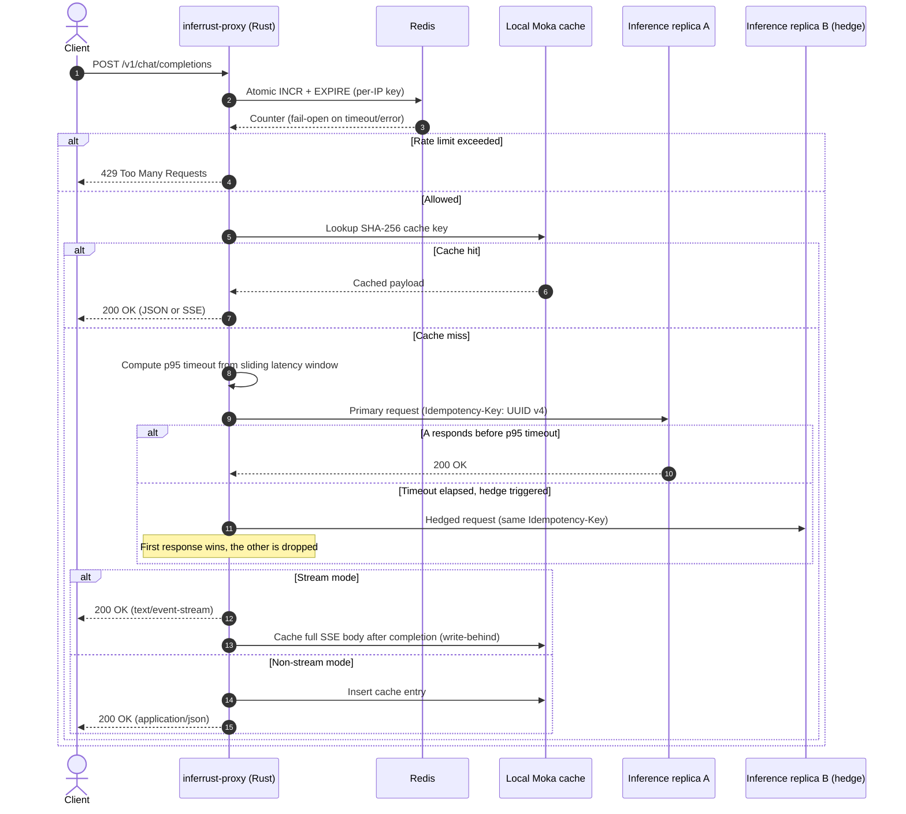

# inferrust-proxy

[](https://www.rust-lang.org/)
[](LICENSE)
[](Dockerfile)

A reverse proxy / sidecar gateway for LLM inference, written in Rust. It sits between your application and a set of inference replicas (vLLM, SGLang or Ollama) and adds response caching, distributed rate limiting and tail-latency mitigation through hedged requests. It exposes an OpenAI-compatible `POST /v1/chat/completions` endpoint.

## Why this exists

LLM inference backends have three recurring problems in multi-user settings:

1. **Repeated work.** Identical prompts are recomputed on the GPU, and each repeat costs seconds of latency.
2. **Unbounded clients.** A burst from one client fills the backend queue and degrades every other user.
3. **Volatile tail latency.** p95/p99 response times swing with queueing and scheduling noise, and a single slow replica can stall a request.

`inferrust-proxy` addresses each one at the edge, so the inference engine only does work that actually needs a GPU.

## Architecture



## Features

### Hedged requests with a dynamic p95 timeout
The proxy keeps a sliding window of observed latencies and derives a p95 timeout from it, following the idea in *The Tail at Scale* (Dean and Barroso). If the primary replica has not responded by then, the same request is sent to a second replica and the first response wins. The slower request is dropped.

For streaming requests the hedge timer watches **time to first token (TTFT)**. Inference engines return HTTP headers once the prefill phase finishes, so the timer measures the compute queue before the long decode phase starts.

### SSE caching with a write-behind pattern
Stream chunks are forwarded to the client immediately through a `tokio::sync::mpsc` channel. A background task (`tokio::spawn`) accumulates the chunks and, when the stream completes, stores the full response in the cache. Caching therefore adds nothing to the critical path of the first request.

### Distributed, fail-open rate limiting
- **Per-IP isolation.** Counters use the key `rate_limit:<ip>`. The client IP comes from `X-Forwarded-For` or `CF-Connecting-IP`, with a fallback to the TCP socket (`ConnectInfo`), which avoids locking out everyone behind the proxy.
- **Atomic window.** `INCR` and `EXPIRE` run in one transactional Redis pipeline (`redis::pipe().atomic()`).
- **Fail-open.** If Redis is unreachable, the proxy logs the failure and lets traffic through instead of rejecting it. This favors availability: limits are **not enforced** during a Redis outage.

### Idempotency key and warm connection pool
Every outgoing request carries an `Idempotency-Key` (UUID v4), and a hedged request reuses the key of its primary. Whether duplicates are deduplicated depends on the backend honoring the header. The `reqwest` client keeps idle connections alive for 60 seconds to avoid repeated connection setup.

### Zero-copy cache hits
Cached JSON and SSE payloads are stored as raw bytes and returned with `axum::body::Body::from(cached_data)`. A hit skips parsing into `serde_json::Value` and re-serialization.

### Load balancing
Requests are distributed across the replicas in `BACKEND_URLS` with an atomic round-robin counter. See the trade-offs below.

## Tech stack

| Area | Crate |
| --- | --- |
| Web framework | `axum` |
| Async runtime | `tokio` |
| Local cache | `moka` |
| Redis client | `redis` (multiplexed async connection) |
| Tokenization | `tokenizers` (prompt length) |
| Serialization | `serde`, `serde_json`, `bincode` |
| IDs and hashing | `uuid`, `sha2`, `hex` |
| HTTP client | `reqwest` |

## Benchmarks

### Setup

- Tool: [`oha`](https://github.com/hatoo/oha)
- 100 requests, 10 concurrent users
- Model: Llama 3 (8B), non-stream (`stream: false`)
- Payload: shared prompts, so repeated requests can be served from the cache
- Compared: Ollama called directly versus the same Ollama behind `inferrust-proxy`

<!-- TODO: add hardware (CPU/GPU/RAM), whether the proxy cache was cold or warm at the start, and the configured rate limit. -->

### Results

| Metric | Direct Ollama | With `inferrust-proxy` | Change |
| --- | --- | --- | --- |
| Total duration | 11 min 01 s | 150.78 ms | ~4,400x faster |
| Throughput | 0.1513 req/s | 663.23 req/s | ~4,380x |
| Average latency | 62.92 s | 13.99 ms | ~4,500x lower |
| Median (p50) | 64.04 s | 8.21 ms | ~7,800x lower |
| Fastest | 32.59 s | 3.36 ms | ~9,700x lower |
| Slowest | 82.41 s | 53.08 ms | ~1,550x lower |
| Status codes | 100 x 200 | 99 x 200, 1 x 429 | |

`oha` counts any HTTP response as a success, so its "100% success rate" includes the single 429.

### How to read these numbers

- This compares a **cache-served workload** against **uncached inference**. It shows what the cache saves when prompts repeat. It does **not** measure the proxy's overhead on cache misses, and it says nothing about the hit rate to expect on real traffic.
- It is one run, on one machine, with 100 requests. Treat the ratios as illustrative.
- The single 429 shows the rate limiter engaging under concurrent load. It is not a validation of the limiter's behavior.
- About 10% of proxy requests landed in the slowest bucket (~51 to 53 ms), several times the median. See the raw report below.

<details>
<summary>Raw <code>oha</code> output: direct Ollama</summary>

```
Summary:
  Success rate: 100.00%
  Total:        11.0172 min
  Slowest:      1.3735 min
  Fastest:      0.5432 min
  Average:      1.0487 min
  Requests/sec: 0.1513

  Total data:   37.88 KiB
  Size/request: 387 B
  Size/sec:     58 B

Response time histogram:
  0.543 min [1]  |
  0.626 min [1]  |
  0.709 min [0]  |
  0.792 min [1]  |
  0.875 min [6]  |■■■■
  0.958 min [8]  |■■■■■■
  1.041 min [19] |■■■■■■■■■■■■■■
  1.124 min [41] |■■■■■■■■■■■■■■■■■■■■■■■■■■■■■■■■
  1.207 min [12] |■■■■■■■■■
  1.290 min [9]  |■■■■■■■
  1.373 min [2]  |■

Response time distribution:
  10.00% in 0.8754 min
  25.00% in 1.0039 min
  50.00% in 1.0673 min
  75.00% in 1.1178 min
  90.00% in 1.2198 min
  95.00% in 1.2335 min
  99.00% in 1.3735 min
  99.90% in 1.3735 min
  99.99% in 1.3735 min
```

</details>

<details>
<summary>Raw <code>oha</code> output: with inferrust-proxy</summary>

```
Summary:
  Success rate: 100.00%
  Total:        150.7766 ms
  Slowest:      53.0750 ms
  Fastest:      3.3621 ms
  Average:      13.9857 ms
  Requests/sec: 663.2328

  Total data:   37.12 KiB
  Size/request: 380 B
  Size/sec:     246.22 KiB

Response time histogram:
   3.362 ms [1]  |
   8.333 ms [53] |■■■■■■■■■■■■■■■■■■■■■■■■■■■■■■■■
  13.305 ms [22] |■■■■■■■■■■■■■
  18.276 ms [4]  |■■
  23.247 ms [5]  |■■■
  28.219 ms [4]  |■■
  33.190 ms [1]  |
  38.161 ms [0]  |
  43.132 ms [0]  |
  48.104 ms [0]  |
  53.075 ms [10] |■■■■■■

Response time distribution:
  10.00% in 4.7986 ms
  25.00% in 6.5280 ms
  50.00% in 8.2138 ms
  75.00% in 12.8601 ms
  90.00% in 51.0860 ms
  95.00% in 52.4045 ms
  99.00% in 53.0750 ms
  99.90% in 53.0750 ms
  99.99% in 53.0750 ms
```

</details>

## LLM inference notes and trade-offs

### Prefill versus decode
Generation has two different bottlenecks. **Prefill** processes all prompt tokens in parallel with large matrix multiplications and is compute-bound. It determines TTFT. **Decode** generates tokens one at a time and must read the model weights and the KV cache from GPU memory at each step, so it is memory-bandwidth-bound and determines inter-token latency. Hedging on the arrival of response headers targets the end of prefill, which is where GPU queueing shows up first.

### Round-robin and the KV cache
Engines such as vLLM use PagedAttention and prefix caching to reuse the KV cache of shared prompt prefixes. Plain round-robin spreads a multi-turn conversation across replicas, which causes artificial prefix-cache misses and repeats prefill work. A production version should use **prefix-aware routing** (for example consistent hashing on the prompt prefix) so requests that share context reach the same replica.

### Tokenization is CPU-bound
Converting text to token ids with the Hugging Face tokenizer is CPU work. Running it directly on Tokio worker threads for very large prompts can block the event loop and raise tail latency for concurrent streams. The non-stream path runs it with `tokio::task::spawn_blocking`:

```rust
let prompt_tokens = tokio::task::spawn_blocking(move || {
    tokenizer
        .encode(full_text, false)
        .map(|encoded| encoded.get_ids().len())
        .unwrap_or(0)
})
.await?;
```

## Limitations and lessons

- **Exact-match cache only.** The key is a SHA-256 of the request, so a prompt that differs by one character misses. There is no semantic caching.
- **Cache is per process.** Each proxy instance has its own Moka cache. Running several instances means several independent caches.
- **Rate limiting depends on Redis.** By design it fails open, so an outage removes the limit.
- **Hedging adds backend load.** In the tail cases the same request runs on two replicas. The saving in latency costs extra compute.
- **No prefix-aware routing.** See the round-robin note above.
- **Negative result.** A zero-heap-allocation optimization of the hot path **lowered** throughput compared with the baseline in my benchmark analysis. I kept it documented as a result instead of presenting it as a win.

<!-- TODO: add the benchmark numbers for the zero-heap experiment (baseline versus optimized, tool, hardware). -->

## Getting started

### Prerequisites

- Rust 1.75+ (bare-metal setup)
- Docker and Docker Compose (recommended)
- The tokenizer file of your target model saved as `tokenizer.json` in the project root

### Option A: Docker Compose (recommended)

This starts the proxy, Redis and an Ollama container.

> Make sure ports `3000` and `11434` are free before starting.

1. Start the services:

   ```bash
   docker-compose up -d --build
   ```

2. Pull a model inside the Ollama container:

   ```bash
   docker exec -it inferrust-ollama ollama pull llama3
   ```

3. Send an OpenAI-compatible request to the proxy:

   ```bash
   curl -X POST http://localhost:3000/v1/chat/completions \
     -H "Content-Type: application/json" \
     -d '{
       "model": "llama3",
       "messages": [{"role": "user", "content": "Hello! Explain briefly how hedged requests work."}],
       "stream": false
     }'
   ```

   Repeat the same request: the second one is served from the cache.

### Option B: Bare metal

1. Clone the repository:

   ```bash
   git clone https://github.com/kaioken13/inferrust-proxy.git
   cd inferrust-proxy
   ```

2. Start Redis:

   ```bash
   redis-server
   ```

3. Configure and run:

   ```bash
   export BACKEND_URLS="http://localhost:11434,http://localhost:11435"
   export RUST_LOG="inferrust_proxy=debug,info"
   export PORT="3000"

   cargo run --release
   ```

### Tests

```bash
cargo test
```

## References

- Jeffrey Dean and Luiz André Barroso, *The Tail at Scale* (Google).
- Woosuk Kwon et al., *Efficient Memory Management for Large Language Model Serving with PagedAttention* (vLLM).
- *HyGen: Efficient LLM Serving via Elastic Online-Offline Request Co-location*, arXiv:2501.14808.
- Cloudflare, *How we built Pingora, the proxy that connects Cloudflare to the Internet*.
- vLLM blog, *Next-Level Inference: Why Your Single-Node vLLM Setup Needs Prefill-Decode Disaggregation*.

## Author

Thiago Aragão da Silva · [GitHub](https://github.com/kaioken13) · [LinkedIn](https://www.linkedin.com/in/thiagoaragao147/)

## License

MIT. See [LICENSE](LICENSE).
