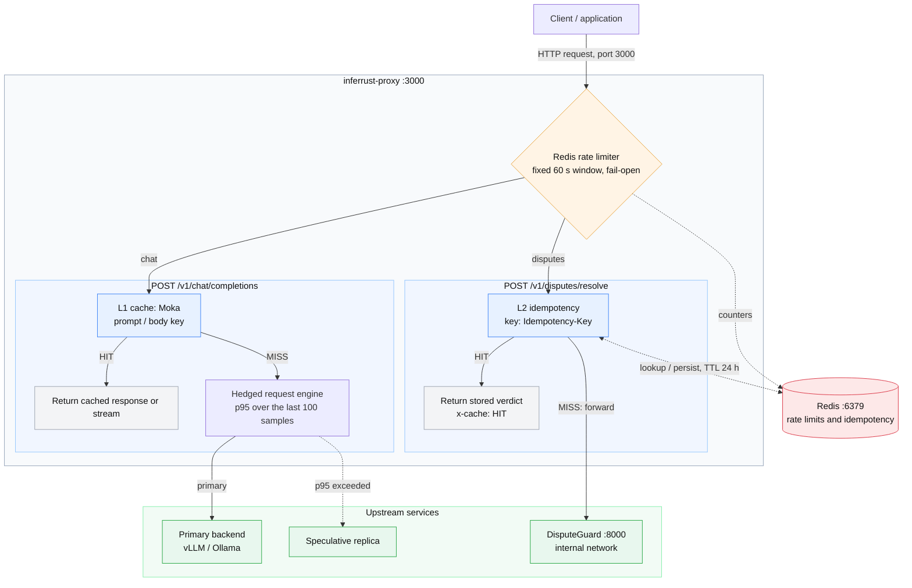

# inferrust-proxy ⚡

[](https://www.rust-lang.org/)
[](https://github.com/tokio-rs/axum)
[](https://redis.io/)
[](Dockerfile)
[](LICENSE)

A lightweight reverse proxy and LLM inference sidecar written in **Rust** using **Axum** and **Tokio**.

`inferrust-proxy` acts as a front-line gateway for downstream AI workloads. It provides local in-memory L1 caching, Redis-backed L2 distributed idempotency, IP-based rate limiting, dynamic latency-based hedging across model replicas, and raw SSE telemetry for Time to First Token (TTFT) and Inter-Token Latency (ITL).

**Contents:** [Architecture](#architecture-overview) · [Capabilities](#core-capabilities) · [Rate limiting](#rate-limiting--fail-open-behavior) · [Quickstart](#end-to-end-quickstart) · [API usage](#api-verification--usage) · [Metrics](#observability--performance-metrics) · [Limitations](#known-limitations--production-roadmap)

---

## Architecture overview



---

## Core capabilities

- **L1 cache (in-memory, Moka):** caches identical requests and full Server-Sent Events (SSE) token streams locally. Each proxy instance has its own L1 cache.
- **L2 distributed idempotency (Redis):** intercepts repeated POST requests that carry the same `Idempotency-Key` header and immediately serves the stored upstream response with the header `x-cache: HIT`.
- **Dynamic tail-latency hedging:** keeps a rolling window of recent response times (N = 100) to calculate the p95 latency. If the primary upstream replica exceeds that threshold, a parallel speculative request goes to an alternate replica and the first response wins.
- **Streaming telemetry (SSE):** inspects chunks on `/v1/chat/completions` (when `stream: true`) to record TTFT and ITL histograms in Prometheus format, without full JSON deserialization.
- **Cache poisoning defense:** only HTTP `2xx` responses are written to the cache. Upstream failures and error status codes are never stored.

### Endpoints

| Method | Path | Upstream | Cache or idempotency |
| :--- | :--- | :--- | :--- |
| `POST` | `/v1/chat/completions` | Inference replicas (vLLM, Ollama) | L1 Moka plus hedging |
| `POST` | `/v1/disputes/resolve` | DisputeGuard (`:8000`, internal) | L2 Redis (`idempotency:<key>`, 24 h TTL) |
| `GET` | `/metrics` | Self | Prometheus metrics |

---

## Rate limiting & fail-open behavior

The proxy contains two rate-limiting implementations with different roles:

1. **Active HTTP middleware (`RedisRateLimiter`):**
   - Uses Redis atomic commands (`INCR` + `EXPIRE`) over a fixed 60-second window.
   - Enforces request quotas per client IP across distributed proxy instances.
2. **In-memory struct (`AtomicRateLimiter`):**
   - Built on a sharded `DashMap<String, Arc<AtomicU64>>`, using 64-bit atomic bit-packing (32 bits for the UNIX epoch in seconds, 32 bits for the request count).
   - Available in the codebase as a building block for single-node deployments. It is not the active middleware.
3. **Fail-open strategy:**
   - If Redis is unreachable, **both the HTTP rate limiter and the dispute idempotency layer fail open**.
   - Requests go through to downstream services instead of being dropped with an HTTP 503.
   - *Trade-off:* during a Redis outage, downstream services must handle their own throttling and duplicate-request protection.

---

## End-to-end quickstart

### Prerequisites

- Docker and Docker Compose (v2+)
- `curl`
- A Groq API key (used by the downstream DisputeGuard service)

### 1. Project directory structure

Keep both projects in adjacent directories to run the integrated stack:

```bash
mkdir -p ~/projects
cd ~/projects

git clone https://github.com/kaioken13/inferrust-proxy.git
git clone https://github.com/kaioken13/disputeguard.git
```

### 2. Integration stack (proxy + Redis + DisputeGuard)

The integration stack runs the proxy as an edge gateway in front of the DisputeGuard API.

```bash
cd ~/projects/inferrust-proxy

# Groq API key used by DisputeGuard
export GROQ_API_KEY="gsk_your_actual_key_here"

# Redis on 6379, proxy on 3000, DisputeGuard on the internal network only
docker compose -f docker-compose.integration.yml up -d --build

# Check that all 3 containers are running
docker compose -f docker-compose.integration.yml ps
```

Expected output:

```text
NAME               IMAGE                             STATUS         PORTS
disputeguard-api   inferrust-infra-disputeguard-api  Up (healthy)   8000/tcp
inferrust-proxy    inferrust-infra-inferrust-proxy   Up             0.0.0.0:3000->3000/tcp
redis              redis:7-alpine                    Up             0.0.0.0:6379->6379/tcp
```

> Redis is published on the host for local testing. Do not expose it outside a trusted network without authentication.

---

## API verification & usage

### 1. Distributed idempotency (`/v1/disputes/resolve`)

#### Step A: first request (MISS, passes through to the upstream)

```bash
curl -i -s -X POST http://localhost:3000/v1/disputes/resolve \
  -H "Content-Type: application/json" \
  -H "Idempotency-Key: delivery-claim-uuid-8841" \
  -d '{
    "order_id": "ORD-101",
    "customer_id": "CUST-01",
    "dispute_text": "Delivery arrived 70 minutes late and the food was completely cold."
  }'
```

Response header: `x-cache: MISS`. Response body: the verdict returned by DisputeGuard.

#### Step B: same key (HIT, immediate return from the edge)

```bash
curl -i -s -X POST http://localhost:3000/v1/disputes/resolve \
  -H "Content-Type: application/json" \
  -H "Idempotency-Key: delivery-claim-uuid-8841" \
  -d '{
    "order_id": "ORD-101",
    "customer_id": "CUST-01",
    "dispute_text": "Delivery arrived 70 minutes late and the food was completely cold."
  }'
```

Response header: `x-cache: HIT`. Response latency: under 5 ms, served from Redis without calling the downstream service.

> **Key matching.** The proxy maps idempotency strictly to the `Idempotency-Key` header (`idempotency:<KEY>`). If a client sends a *different* body with an already-used key, the proxy returns the original cached response. A hardened version would combine the key with a hash of the request payload (for example `SHA-256(body)`) and reject mismatches with HTTP 422.

### 2. Standalone inference and hedging stack (proxy + Ollama replicas)

To run the proxy against dedicated inference backends:

```bash
cd ~/projects/inferrust-proxy

# BPE tokenizer file used to count prompt tokens locally
curl -s -L -o tokenizer.json https://huggingface.co/NousResearch/Meta-Llama-3-8B/raw/main/tokenizer.json

# Start the inference stack
docker compose -f docker-compose.yml up -d --build

# Pull the model into both replicas
docker exec -it ollama-a ollama pull llama3:8b
docker exec -it ollama-b ollama pull llama3:8b
```

#### Streaming request (SSE) with metrics tracking

```bash
curl -N -X POST http://localhost:3000/v1/chat/completions \
  -H "Content-Type: application/json" \
  -d '{
    "model": "llama3:8b",
    "messages": [{"role": "user", "content": "Explain CAP theorem in two sentences."}],
    "stream": true
  }'
```

---

## Observability & performance metrics

### Measured latencies

| Path | Conditions | Result |
| :--- | :--- | :--- |
| L1 cache HIT (Moka) | 10 concurrent clients (`oha`) | p50 = 8.21 ms, mean = 13.99 ms, min = 3.4 ms |
| L2 Redis HIT | Single request over the local Docker network | under 5 ms |
| Upstream dispute round trip | DisputeGuard evaluation cases that did not hit the Groq rate limit (3 cases) | about 627 ms to 1,602 ms |

The L1 figures come from one `oha` run on one machine. The upstream figure comes from the DisputeGuard `make eval` run, which calls the model provider directly.

### Prometheus endpoint (`/metrics`)

The proxy exposes a Prometheus scrape target on port `3000`:

```bash
curl -s http://localhost:3000/metrics | grep -E "(llm_|request_)"
```

- `llm_time_to_first_token_seconds`: histogram of the time from request receipt until the first SSE data chunk arrives from the upstream provider (network plus prefill).
- `llm_inter_token_latency_seconds`: histogram of the time between consecutive streaming chunks (decode throughput).
- `x-prompt-tokens` (response header): prompt token count computed locally with Hugging Face tokenizers before the request goes upstream.

---

## Known limitations & production roadmap

1. **Payload-unaware idempotency.** The Redis key comes only from the header value. A client that reuses a key with different content receives the stored response instead of an HTTP 422.
2. **Fail-open idempotency during outages.** If Redis is down, dispute requests go straight to the upstream without deduplication, so duplicate protection falls to the downstream service.
3. **Fixed-window rate limiter.** The active Redis limiter uses a 60-second fixed window, not a sliding log or token bucket, so bursts can pass around the window reset.
4. **Hedging footprint.** Speculative duplicate requests at high p95 increase total backend load. Replica pools need headroom for the duplicates.
5. **Per-instance L1 cache, exact matching.** Each proxy instance has its own Moka cache, and only identical requests hit it.
6. **Benchmark scope.** The L1 numbers come from a single `oha` run. They measure cache hits and say nothing about the proxy's overhead on cache misses.

---

## 👨‍💻 Author

**Thiago Aragão da Silva**<br/>
Data Science undergraduate at University of São Paulo (ICMC-USP)<br/>
Focus: Systems Engineering, MLOps & High-Performance AI Gateways<br/>
[GitHub](https://github.com/kaioken13) · [LinkedIn](https://www.linkedin.com/in/thiagoaragao147/)

## 📜 License

MIT License. See [LICENSE](LICENSE) for details.
